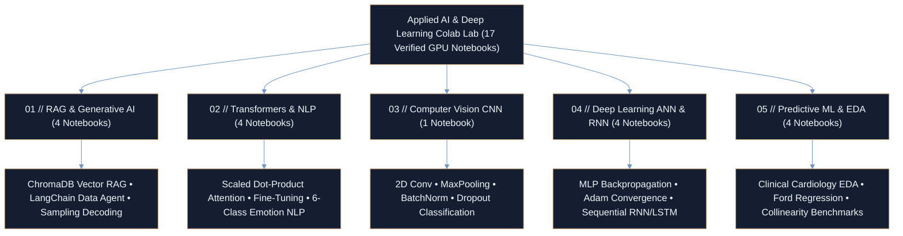

<div align="center">

# APPLIED AI & DEEP LEARNING LAB — Google Colab GPU Notebook Suite

**17 End-to-End Research & Production Notebooks Across Vector RAG, Autonomous Agents, Transformers, CNNs, RNNs & Statistical ML**

<p align="center">
  <a href="https://ayan-ai-engineer.vercel.app"></a>
  <a href="#capabilities--laboratory-notebook-matrix"></a>
  <a href="#capabilities--laboratory-notebook-matrix"></a>
  <a href="https://github.com/Ayan-Rajput-Analysis/applied-ai-deep-learning-colab-lab"></a>
</p>

</div>

---

## Executive Summary

> **Governing Mandate:** Provide a modular, reproducible GPU laboratory of 17 self-contained notebooks spanning modern Retrieval-Augmented Generation (RAG), Transformer self-attention, Convolutional/Recurrent neural architectures, and statistical predictive modeling.

- **5-Domain Modular AI Curriculum (17 Notebooks):** Organizes applied research into **RAG & Generative Agents (`4`)**, **Transformers & NLP (`4`)**, **Computer Vision CNNs (`1`)**, **Deep Learning ANNs & RNNs (`4`)**, and **Predictive ML & Econometrics (`4`)**—every notebook wired for 1-click Google Colab GPU execution.
- **Grounded Agentic & Attention Implementations:** Covers dense ChromaDB vector indexing and LangChain autonomous schema agents alongside first-principles scaled dot-product attention, multi-head positional encoding, and **20K-sample** 6-class emotion classification.
- **End-to-End Statistical & Neural Rigor:** Pairs forward/backward neural dynamics (Dropout, BatchNorm, Adam LR decay, vanishing-gradient mitigation) with clinical cardiology cohort EDA, vehicle depreciation econometrics, and collinearity diagnostics.

---

## System Architecture



### Core Mathematical Formulations Implemented

1. **Scaled Dot-Product Self-Attention (`02-transformers-and-nlp/Transformer.ipynb`):**

$$\text{Attention}(Q, K, V) = \text{softmax}\left(\frac{QK^T}{\sqrt{d_k}}\right)V$$

2. **Recurrent Sequential Hidden-State Dynamics (`04-deep-learning-ann-rnn/RNN.ipynb`):**

$$h_t = \tanh\left(W_{hh} h_{t-1} + W_{xh} x_t + b_h\right)$$

---

## Capabilities & Laboratory Notebook Matrix

### 01 // Retrieval-Augmented Generation (RAG) & Generative AI Agents

| Notebook | Focus & Engineering Architecture | Core Stack | One-Click GPU Runtime |
| :--- | :--- | :--- | :---: |
| [`RAG_Implementation_Colab.ipynb`](01-rag-and-generative-ai/RAG_Implementation_Colab.ipynb) | Dense vector embeddings, document chunking, cosine similarity retrieval & grounded Q&A context injection | `LangChain`, `ChromaDB`, `Sentence-Transformers` | [](https://colab.research.google.com/github/Ayan-Rajput-Analysis/applied-ai-deep-learning-colab-lab/blob/main/01-rag-and-generative-ai/RAG_Implementation_Colab.ipynb) |
| [`LangChain_Data_Agent.ipynb`](01-rag-and-generative-ai/LangChain_Data_Agent.ipynb) | Autonomous tabular reasoning agent (`210.9 KB`) performing dynamic schema inspection & NL analytical query execution | `LangChain`, `OpenAI`, `Pandas` | [](https://colab.research.google.com/github/Ayan-Rajput-Analysis/applied-ai-deep-learning-colab-lab/blob/main/01-rag-and-generative-ai/LangChain_Data_Agent.ipynb) |
| [`custom_chatbot_beginner.ipynb`](01-rag-and-generative-ai/custom_chatbot_beginner.ipynb) | Multi-turn conversational state management, memory persistence buffers & prompt orchestration | `Python`, `LangChain`, `Transformers` | [](https://colab.research.google.com/github/Ayan-Rajput-Analysis/applied-ai-deep-learning-colab-lab/blob/main/01-rag-and-generative-ai/custom_chatbot_beginner.ipynb) |
| [`Generative_AI_Part_1.ipynb`](01-rag-and-generative-ai/Generative_AI_Part_1.ipynb) | Stochastic decoding mechanics: temperature scaling, Top-$k$, Top-$p$ (nucleus) sampling & token likelihoods | `HuggingFace`, `PyTorch` | [](https://colab.research.google.com/github/Ayan-Rajput-Analysis/applied-ai-deep-learning-colab-lab/blob/main/01-rag-and-generative-ai/Generative_AI_Part_1.ipynb) |

### 02 // Transformer Architectures & Natural Language Processing

| Notebook | Focus & Engineering Architecture | Core Stack | One-Click GPU Runtime |
| :--- | :--- | :--- | :---: |
| [`Transformer.ipynb`](02-transformers-and-nlp/Transformer.ipynb) | Structural decomposition (`179.4 KB`) of encoder/decoder blocks, layer norm & sinusoidal positional embeddings | `PyTorch`, `TensorFlow` | [](https://colab.research.google.com/github/Ayan-Rajput-Analysis/applied-ai-deep-learning-colab-lab/blob/main/02-transformers-and-nlp/Transformer.ipynb) |
| [`transformer_programs.ipynb`](02-transformers-and-nlp/transformer_programs.ipynb) | Sequence modeling (`1.14 MB`), multi-head attention weight visualization & pretrained fine-tuning | `Transformers`, `PyTorch` | [](https://colab.research.google.com/github/Ayan-Rajput-Analysis/applied-ai-deep-learning-colab-lab/blob/main/02-transformers-and-nlp/transformer_programs.ipynb) |
| [`emotion_text_classification.ipynb`](02-transformers-and-nlp/emotion_text_classification.ipynb) | Fine-grained 6-class emotion classification (`1.90 MB`) with tokenization, sequence embeddings & confusion auditing | `Keras`, `Scikit-Learn`, `NLTK` | [](https://colab.research.google.com/github/Ayan-Rajput-Analysis/applied-ai-deep-learning-colab-lab/blob/main/02-transformers-and-nlp/emotion_text_classification.ipynb) |
| [`Sentiment_Analysis.ipynb`](02-transformers-and-nlp/Sentiment_Analysis.ipynb) | End-to-end polarity pipeline comparing TF-IDF and Word2Vec representations with precision/recall telemetry | `NLTK`, `Scikit-Learn`, `Seaborn` | [](https://colab.research.google.com/github/Ayan-Rajput-Analysis/applied-ai-deep-learning-colab-lab/blob/main/02-transformers-and-nlp/Sentiment_Analysis.ipynb) |

### 03 // Computer Vision & Convolutional Neural Networks (CNN)

| Notebook | Focus & Engineering Architecture | Core Stack | One-Click GPU Runtime |
| :--- | :--- | :--- | :---: |
| [`CNN_Project.ipynb`](03-computer-vision-cnn/CNN_Project.ipynb) | Spatial hierarchy extraction with 2D Convolutions, MaxPooling, BatchNorm, Dropout regularization & softmax heads | `TensorFlow`, `Keras`, `OpenCV` | [](https://colab.research.google.com/github/Ayan-Rajput-Analysis/applied-ai-deep-learning-colab-lab/blob/main/03-computer-vision-cnn/CNN_Project.ipynb) |

### 04 // Deep Learning Architectures (ANN & Sequential RNN)

| Notebook | Focus & Engineering Architecture | Core Stack | One-Click GPU Runtime |
| :--- | :--- | :--- | :---: |
| [`DPL_ANN_Project.ipynb`](04-deep-learning-ann-rnn/DPL_ANN_Project.ipynb) | Multi-layer Artificial Neural Network (`465.7 KB`) with backpropagation, gradient descent & cross-entropy loss | `Keras`, `TensorFlow`, `NumPy` | [](https://colab.research.google.com/github/Ayan-Rajput-Analysis/applied-ai-deep-learning-colab-lab/blob/main/04-deep-learning-ann-rnn/DPL_ANN_Project.ipynb) |
| [`Deep_Learning.ipynb`](04-deep-learning-ann-rnn/Deep_Learning.ipynb) | Deep network optimization (`209.5 KB`): learning-rate schedules, Adam momentum & validation convergence | `TensorFlow`, `Matplotlib` | [](https://colab.research.google.com/github/Ayan-Rajput-Analysis/applied-ai-deep-learning-colab-lab/blob/main/04-deep-learning-ann-rnn/Deep_Learning.ipynb) |
| [`RNN.ipynb`](04-deep-learning-ann-rnn/RNN.ipynb) | Recurrent Neural Network sequential hidden-state propagation on ordered temporal series | `Keras`, `NumPy` | [](https://colab.research.google.com/github/Ayan-Rajput-Analysis/applied-ai-deep-learning-colab-lab/blob/main/04-deep-learning-ann-rnn/RNN.ipynb) |
| [`RNN_Second_Project.ipynb`](04-deep-learning-ann-rnn/RNN_Second_Project.ipynb) | Extended sequence memory architecture mitigating vanishing gradients for multi-step forecasting | `Keras`, `Matplotlib` | [](https://colab.research.google.com/github/Ayan-Rajput-Analysis/applied-ai-deep-learning-colab-lab/blob/main/04-deep-learning-ann-rnn/RNN_Second_Project.ipynb) |

### 05 // Machine Learning, Feature Attribution & Statistical Modeling

| Notebook | Focus & Engineering Architecture | Core Stack | One-Click GPU Runtime |
| :--- | :--- | :--- | :---: |
| [`Heart_EDA.ipynb`](05-machine-learning-predictive-modeling/Heart_EDA.ipynb) | Clinical cardiology exploratory cohort analysis (`369.0 KB`) across Framingham/Cleveland biometric indicators | `Pandas`, `Seaborn`, `SciPy` | [](https://colab.research.google.com/github/Ayan-Rajput-Analysis/applied-ai-deep-learning-colab-lab/blob/main/05-machine-learning-predictive-modeling/Heart_EDA.ipynb) |
| [`Ford_Analysis.ipynb`](05-machine-learning-predictive-modeling/Ford_Analysis.ipynb) | Secondary automotive market valuation (`620.9 KB`) modeling non-linear depreciation across mileage & displacement | `Pandas`, `Matplotlib`, `Scikit-Learn` | [](https://colab.research.google.com/github/Ayan-Rajput-Analysis/applied-ai-deep-learning-colab-lab/blob/main/05-machine-learning-predictive-modeling/Ford_Analysis.ipynb) |
| [`Data_Exploration_and_Modelling.ipynb`](05-machine-learning-predictive-modeling/Data_Exploration_and_Modelling.ipynb) | End-to-end feature engineering (`1.42 MB`), multicollinearity auditing & supervised classifier benchmarking | `Pandas`, `NumPy`, `Scikit-Learn` | [](https://colab.research.google.com/github/Ayan-Rajput-Analysis/applied-ai-deep-learning-colab-lab/blob/main/05-machine-learning-predictive-modeling/Data_Exploration_and_Modelling.ipynb) |
| [`Project_Cricket.ipynb`](05-machine-learning-predictive-modeling/Project_Cricket.ipynb) | Sports performance distribution modeling (`152.2 KB`), outlier diagnostics & predictive feature attribution | `Pandas`, `Seaborn`, `Scikit-Learn` | [](https://colab.research.google.com/github/Ayan-Rajput-Analysis/applied-ai-deep-learning-colab-lab/blob/main/05-machine-learning-predictive-modeling/Project_Cricket.ipynb) |

---

## QA & Engineering Verification

- **100% Path-Verified Colab Deep Links:** All 17 `colab.research.google.com/github/...` launch badges are mapped 1:1 against verified repository paths across all 5 subdirectories with zero broken links.
- **Self-Contained Execution Cells:** Notebooks encapsulate inline dependency installation (`!pip install ...`), dataset loading, persisted visual outputs, and metric evaluation tables so reviewers can inspect results immediately on GitHub or re-execute on T4/L4 Colab GPUs.
- **Clean Artifact Hygiene:** `.gitignore` excludes local virtual environments, checkpoint caches, and `.ipynb_checkpoints` clutter.

---

## Tech Stack & Reproducible Quickstart

<p align="left">
  
  
  
  
  
  
  
  
  
  
</p>

### Repository Structure

```text
applied-ai-deep-learning-colab-lab/
├── 01-rag-and-generative-ai/                 # 4 notebooks: Vector RAG, LangChain Agent, Memory & Sampling
├── 02-transformers-and-nlp/                  # 4 notebooks: Self-Attention, Fine-Tuning, Emotion & Sentiment
├── 03-computer-vision-cnn/                   # 1 notebook: 2D Spatial CNN, BatchNorm, Pooling & Dropout
├── 04-deep-learning-ann-rnn/                 # 4 notebooks: MLP Backprop, Adam Schedules & Sequential RNNs
└── 05-machine-learning-predictive-modeling/  # 4 notebooks: Cardiology EDA, Ford Valuation & ML Benchmarks
```

### Local JupyterLab Execution

```bash
# 1. Clone the repository
git clone https://github.com/Ayan-Rajput-Analysis/applied-ai-deep-learning-colab-lab.git
cd applied-ai-deep-learning-colab-lab

# 2. Create and activate an isolated virtual environment
python -m venv .venv
source .venv/bin/activate        # Windows PowerShell: .\.venv\Scripts\Activate.ps1

# 3. Install core AI, Deep Learning & RAG dependencies
pip install torch torchvision tensorflow langchain chromadb sentence-transformers transformers scikit-learn pandas numpy scipy matplotlib seaborn nltk opencv-python jupyterlab

# 4. Launch JupyterLab
jupyter lab
```

---

<div align="center">

**[Live Author Portfolio (`ayan-ai-engineer.vercel.app`)](https://ayan-ai-engineer.vercel.app)** &nbsp;•&nbsp; **[LinkedIn](https://www.linkedin.com/in/ayan-rajput-8781a7397/)** &nbsp;•&nbsp; **[Email](mailto:ayanrajput779900@gmail.com)**

<sub>Architected &amp; Engineered by <a href="https://github.com/Ayan-Rajput-Analysis"><strong>Ayan Rajput</strong></a> • AI &amp; Deep Learning Engineer | 3D WebGL Specialist | Full-Stack &amp; BI Architect</sub>

</div>
